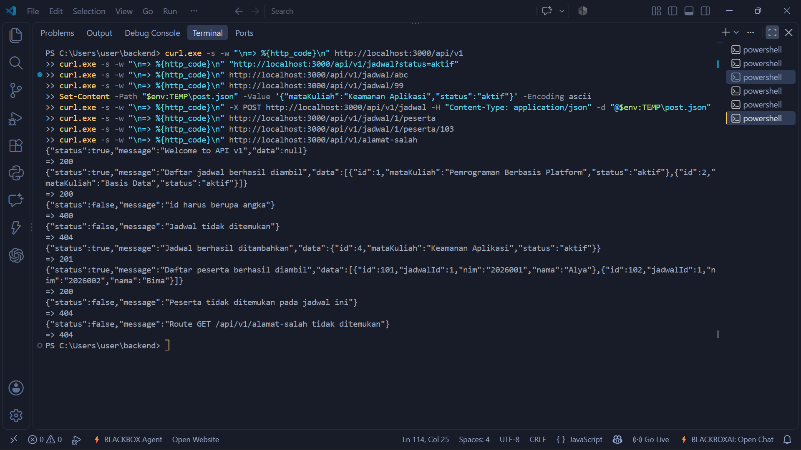
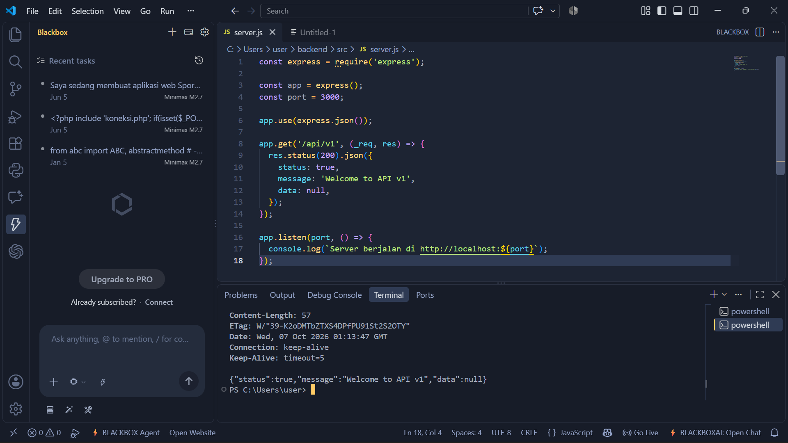
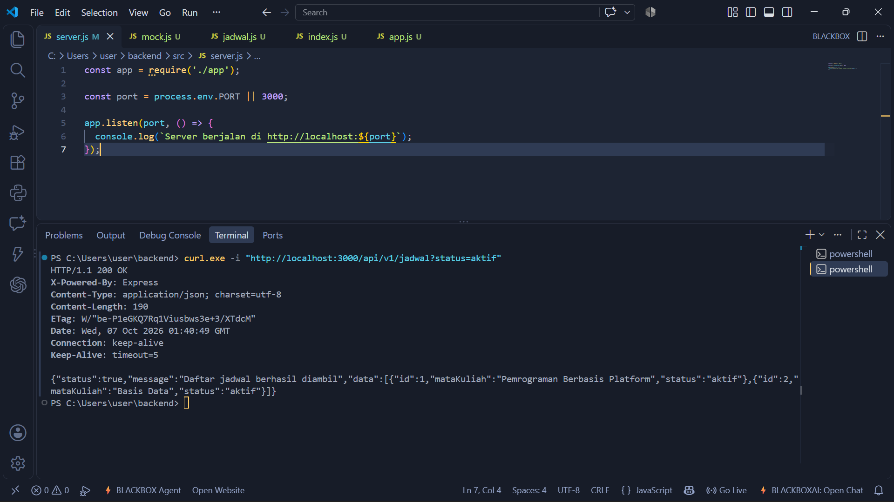
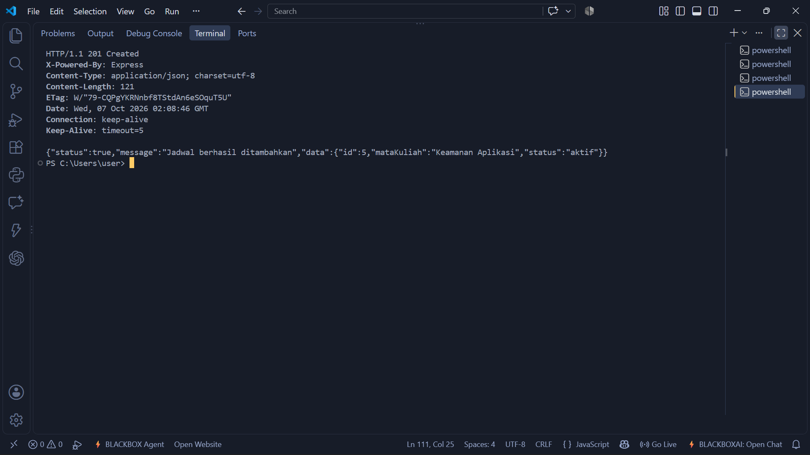
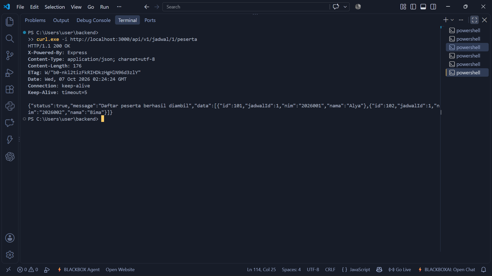
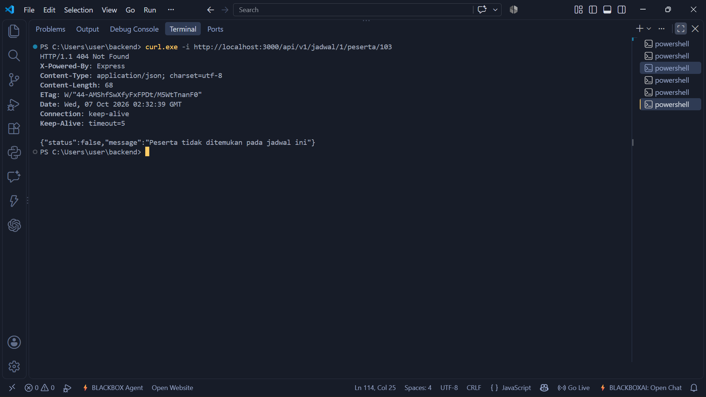

# Dokumentasi Routing API — Pertemuan 2

Kelompok 15 — Aplikasi Pengaduan dan Monitoring Permasalahan Fakultas Berbasis Mobile

API latihan dibuat dengan Express 4.21.2. Base URL: `http://localhost:3000/api/v1`.
Resource utama adalah `jadwal`, sedangkan `peserta` adalah subresource dari satu jadwal.
Data masih berupa array di memori (`backend/src/data/mock.js`), sehingga perubahan hilang saat server dimulai ulang.

## 1. Arsitektur

> Tempelkan Gambar 4.1 (alur kerja praktikum) dan Gambar 4.2 (komposisi prefix route) dari template modul di bagian ini.

URL akhir dibentuk dari tiga lapis: prefix `/api/v1` (di `app.js`), prefix `/jadwal` (di `routes/index.js`), dan path pada router anak (`routes/jadwal.js` dan `routes/peserta.js`).

Struktur backend:

```
backend/
├── package.json
├── package-lock.json
└── src/
    ├── app.js
    ├── server.js
    ├── data/
    │   └── mock.js
    └── routes/
        ├── index.js
        ├── jadwal.js
        └── peserta.js
```

## 2. Daftar route

| No | Method | URL | Asal input | Status sukses | Status gagal |
|----|--------|-----|------------|---------------|--------------|
| 1 | GET | `/api/v1` | — | 200 | — |
| 2 | GET | `/api/v1/jadwal` | query: `status` (opsional) | 200 | — |
| 3 | GET | `/api/v1/jadwal/jumlah-jadwal` | — | 200 | — |
| 4 | GET | `/api/v1/jadwal/:id` | params: `id` | 200 | 400 (id bukan angka), 404 (tidak ada) |
| 5 | POST | `/api/v1/jadwal` | body: `mataKuliah`, `status` | 201 | 400 (`mataKuliah` kosong) |
| 6 | PUT | `/api/v1/jadwal/:id` | params: `id`, body: `mataKuliah`, `status` | 200 | 404 (tidak ada) |
| 7 | DELETE | `/api/v1/jadwal/:id` | params: `id` | 200 | 404 (tidak ada) |
| 8 | GET | `/api/v1/jadwal/:jadwalId/peserta` | params: `jadwalId` | 200 | 404 (jadwal tidak ada) |
| 9 | POST | `/api/v1/jadwal/:jadwalId/peserta` | params: `jadwalId`, body: `nim`, `nama` | 201 | 404 (jadwal tidak ada), 400 (body tidak lengkap) |
| 10 | GET | `/api/v1/jadwal/:jadwalId/peserta/:pesertaId` | params: `jadwalId`, `pesertaId` | 200 | 404 (peserta tidak ada pada jadwal ini) |
| 11 | GET | route lain yang tidak terdaftar | — | — | 404 (fallback route) |

Semua response memakai format `{ "status": true/false, "message": "...", "data": ... }`.

## 3. Contoh response

**GET `/api/v1`** — 200
```json
{"status":true,"message":"Welcome to API v1","data":null}
```

**GET `/api/v1/jadwal?status=aktif`** — 200
```json
{"status":true,"message":"Daftar jadwal berhasil diambil","data":[{"id":1,"mataKuliah":"Pemrograman Berbasis Platform","status":"aktif"},{"id":2,"mataKuliah":"Basis Data","status":"aktif"}]}
```

**GET `/api/v1/jadwal/abc`** — 400
```json
{"status":false,"message":"id harus berupa angka"}
```

**GET `/api/v1/jadwal/99`** — 404
```json
{"status":false,"message":"Jadwal tidak ditemukan"}
```

**POST `/api/v1/jadwal`** — 201
```json
{"status":true,"message":"Jadwal berhasil ditambahkan","data":{"id":4,"mataKuliah":"Keamanan Aplikasi","status":"aktif"}}
```

**GET `/api/v1/jadwal/1/peserta`** — 200
```json
{"status":true,"message":"Daftar peserta berhasil diambil","data":[{"id":101,"jadwalId":1,"nim":"2026001","nama":"Alya"},{"id":102,"jadwalId":1,"nim":"2026002","nama":"Bima"}]}
```

**GET `/api/v1/jadwal/1/peserta/103`** — 404
```json
{"status":false,"message":"Peserta tidak ditemukan pada jadwal ini"}
```

**GET `/api/v1/alamat-salah`** — 404
```json
{"status":false,"message":"Route GET /api/v1/alamat-salah tidak ditemukan"}
```

## 4. Tabel pengujian

| No | Request | Harapan | Hasil aktual |
|----|---------|---------|--------------|
| 1 | `GET /api/v1` | 200, pesan welcome | 200, `Welcome to API v1` |
| 2 | `GET /api/v1/jadwal?status=aktif` | 200, hanya data aktif | 200, hanya jadwal id 1 dan 2 |
| 3 | `GET /api/v1/jadwal/abc` | 400, id harus angka | 400, `id harus berupa angka` |
| 4 | `GET /api/v1/jadwal/99` | 404, jadwal tidak ditemukan | 404, `Jadwal tidak ditemukan` |
| 5 | `POST /api/v1/jadwal` dengan body valid | 201, objek baru | 201, jadwal baru "Keamanan Aplikasi" |
| 6 | `GET /api/v1/jadwal/1/peserta` | 200, peserta jadwal 1 | 200, Alya dan Bima |
| 7 | `GET /api/v1/jadwal/1/peserta/103` | 404, peserta berada di jadwal lain | 404, `Peserta tidak ditemukan pada jadwal ini` |
| 8 | `GET /api/v1/alamat-salah` | 404, fallback route | 404, `Route GET /api/v1/alamat-salah tidak ditemukan` |



## 5. Bukti implementasi (screenshot)

**Route welcome**



**Filter dengan query string**



**POST sukses**



**Route bersarang (GET peserta pada jadwal 1)**



**Kasus negatif (peserta tidak ada pada jadwal)**



## 6. Perbedaan dengan sistem ATLAS

API latihan ini mengembalikan **404** untuk resource atau route yang tidak ditemukan, karena itu semantik HTTP yang lazim. Sistem ATLAS yang asli memiliki perilaku lama: mengembalikan **500** dengan pesan `Api tidak tersedia` untuk path API yang tidak cocok. Status 500 menandakan kesalahan di sisi server, padahal yang terjadi adalah kesalahan alamat dari client, sehingga 404 adalah rancangan yang lebih tepat. Route latihan sengaja tidak diubah menjadi 500.
